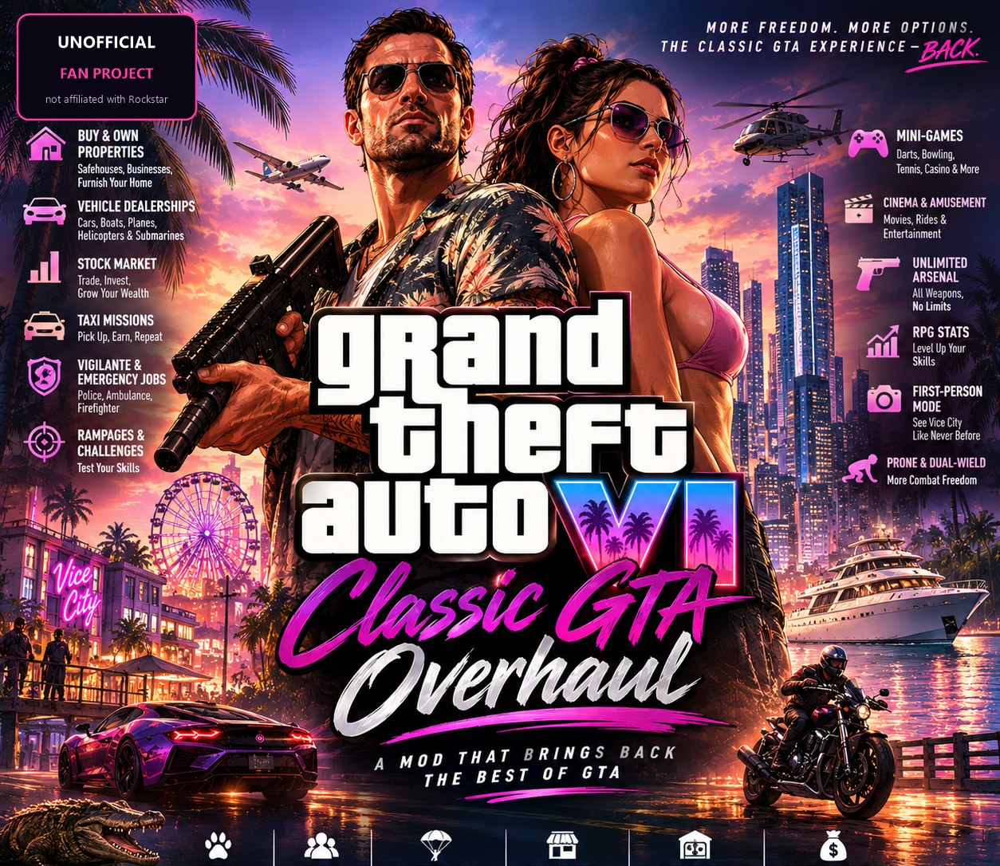
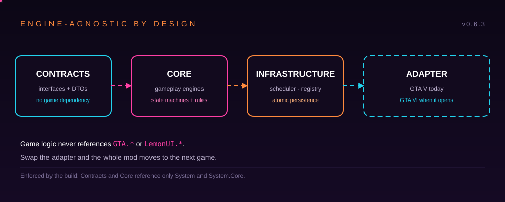

<div align="center">
  

  <h1>Classic GTA Overhaul</h1>

  <p><b>We waited over a decade for the GOTY GTA sandbox experience — and didn't get the freedom we grew up loving.</b><br>
  So we're bringing the community together to build the <b>GTA VI PC</b> experience we deserved — playable on <b>GTA V Legacy</b> today, and ready for <b>GTA VI PC Day 1</b>.</p>

  <p>
    <a href="https://discord.gg/ptHPBCvy"></a>
    
    
    
    
  </p>
</div>

<div align="center">
  
</div>

<p align="center"><sub>Unofficial fan project (GPL-3.0). Not affiliated with, endorsed by or sponsored by Rockstar Games or Take-Two Interactive. Story Mode only · Free forever · No ripped assets.</sub></p>

---

## Why we're building this

We were supposed to get the definitive, once-in-a-generation **GOTY sandbox** — instead, modern entries kept trading classic arcade freedom for realism chores, stripped-back side-hustles, and locked-down interiors.

**Classic GTA Overhaul** is our answer: a community-driven, 100% free and open-source overhaul that puts the **fun, freedom, and chaos** back in your hands:
- **Steal any car instantly** — no lockpick QTEs, no endless alarms.
- **Outrun the cops the classic way** — 20 seconds out of sight clears your stars & heat, or hit a `$500` Pay 'n' Spray bribe.
- **Take over the city** — San Andreas-style 3-wave Gang Territory / Turf Wars with capture bonuses and daily passive turf income.
- **Live the full sandbox** — buy safehouses & businesses, play 21 Blackjack, trade LCN stocks, run Taxi & 911 jobs, summon your Kraken sub, call buddies, and adopt guard dogs.
- **Playable today, ready for tomorrow** — runs on **GTA V Legacy (PC)** right now (`1.0.3889.0` verified), and built with zero engine lock-in so the entire gameplay pack moves straight to **GTA VI PC** the day modding opens.

<div align="center">
  <br>
  
</div>

---

## What's in the build today (`F7` In-Game Hub)

**Legend:** ✅ playable through the `F7` hub · 🧪 built & tested in the lab · 🔒 under wraps

| | Feature | What it brings back | Status |
|:--:|:--|:--|:--:|
| 🚗 | **Instant Car Theft** | Instant unlock, kill car alarms, pacify drivers — zero lockpick QTEs. Never touches or deletes your own cars. | ✅ |
| ⭐ | **Classic Wanted & Bribes** | 20s out-of-sight police cooldown + `$500` Pay 'n' Spray bribe clearing stars & Criminal Profile Heat. | ✅ |
| ⛽ | **Arcade Freedom** | One-click toggles for No Refuelling / Engine Top-Up, No Survival Chores (stamina), and optional No Vignette. | ✅ |
| 🎮 | **Classic Sandbox Cheats** | Story-Mode Health/Armor, Clear/Never Wanted, Super Jump, Repair, Classic Car Spawner, Weather & Clock `+6h`. | ✅ |
| 🏴 | **Gang Territory / Turf Wars** | 4 districts (`Davis`, `Del Perro`, `Downtown`, `LS Docks`), 3 hostile waves, `$5,000` capture bonus & `$2,500`/day turf income. | ✅ |
| 🚕 | **Taxi Shift** | Pick up fares, beat the par time, earn distance + speed tips. Your cab is always protected. | ✅ |
| 🚨 | **911 Dispatch** | Call Police backup, Ambulance (heals on arrival), or Fire Dept — they spawn on real roads and drive to you. | ✅ |
| 🔫 | **Pocket Arsenal + Safe Zones** | Every valid weapon with max ammo, plus restored combat controls & weapons inside restricted interiors. | ✅ |
| 📈 | **LCN Stock Market** | Buy, sell & hold shares with live market ticks and persistent portfolios across saves. | ✅ |
| 🃏 | **Casino Blackjack** | Rules-complete 21 with soft aces, double down, and 3:2 naturals — Story Mode cash only. | ✅ |
| 🐕 | **Guard Dogs** | Buy a Rottweiler, Shepherd, or Husky; summon them and command Follow, Sit, or Guard. | ✅ |
| 💵 | **Money, Properties & Kraken** | Story Cash & Mod Wallet menu, safehouses, passive business income, open-water Kraken delivery, 12-level emergency jobs & buddy hangouts. | ✅ |

**Coming out of the lab next:** 🖥️ ClassicNet in-game web hub · 🛋️ Safehouse furniture placement · 💀 Timed Rampages & medals · 🎥 Head-tracked First-Person camera · 📊 RPG skill trees

---

## Join the community — let's build the GTA VI PC we deserved

This isn't a solo project — it's a call to every modder, developer, artist, and GTA fan who wants the classic sandbox back. **Anyone can apply** (prior modding or dev experience recommended).

<div align="center">
  <a href="https://discord.gg/ptHPBCvy">
    
  </a>
</div>

<br>

| Role | What you'll help build |
|:--|:--|
| **C# / Gameplay Modders** | New classic activities, turf war expansion, safehouse interiors, RPG perks. |
| **SHVDN3 / RAGE Native Researchers** | World spawns, AI tasks, animations, cameras, and Day-1 GTA VI adapter prep. |
| **LemonUI / HUD & UX** | Making the `F7` hub, prompts, and visual feedback feel native to GTA. |
| **3D / Art / Video** | Custom props, icons, key art, gameplay trailers & showcase clips. |
| **QA & GTA V Legacy Testers** | Breaking builds in-game, reporting logs, testing new features first. |

**How to jump in:** Join our **[Discord (`discord.gg/ptHPBCvy`)](https://discord.gg/ptHPBCvy)** and drop your role + what classic GTA feature you want to build or test first, or pick an issue in [`CONTRIBUTING.md`](CONTRIBUTING.md).

---

## Under the hood & verified stats

<div align="center">
  
</div>

<details>
<summary><b>Click to expand build commands &amp; real measured stats (136/136 tests · 17/17 probes)</b></summary>

<br>

| Metric | Measured Value |
|:--|:--|
| **Production C# source** | **84 files · 7,732 lines** (`31` Contracts · `23` Core · `4` Infrastructure · `23` GTA V Adapter) |
| **Automated tests** | **136/136 PASS** (`12` test files · `3,557` lines · `0` warnings with `TreatWarningsAsErrors=true`) |
| **Sabotage probes (`/kee`)** | **17/17 RED → restored GREEN** (breaks real guards, asserts exact `[FAIL]`, restores byte-identical) |
| **Engine isolation** | **0 `GTA.*` / `LemonUI.*` refs** across all `54` files in `ClassicGTA.Contracts` + `ClassicGTA.Core` |
| **Live GTA V Legacy load** | **Verified on `1.0.3889.0`** (`ScriptHookV 3889.0` + `SHVDN v3.7.0-nightly.206`, `0` log errors) |

```powershell
# Windows · .NET Framework 4.8 · Visual Studio Build Tools
.\build.ps1     # restores pinned packages, builds 5 projects, runs 136/136 tests
.\probe.ps1     # 17 sabotage probes: break a guard, watch the right test go red, restore
```

Player install steps & developer guide live in [`docs/BUILDING.md`](docs/BUILDING.md) · Full feature matrix in [`docs/FEATURES.md`](docs/FEATURES.md) · [`docs/FAQ.md`](docs/FAQ.md).

</details>

---

<div align="center">
  <b>Free &amp; Open Source Forever (<a href="LICENSE">GPL-3.0</a>) · Story Mode Only · Built by the Community</b><br>
  <sub>⭐ Star the repo · 💬 <a href="https://discord.gg/ptHPBCvy">Join the Discord</a> · 🐞 Open an issue</sub>
</div>
