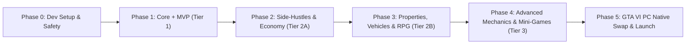

# MVP Scope & Step-by-Step Execution Roadmap

This document defines the **Minimum Viable Product (MVP)** and the exact **Phase-Gated Engineering Roadmap** for building the **"Classic GTA" Overhaul Mod** in GTA V (PC) and porting it cleanly to GTA VI (PC).

---

## 1. Minimum Viable Product (MVP — v0.1 "Sandbox Unchained")

Before building complex economy systems or custom animations, we ship a rock-solid, zero-crash **MVP** that proves the architecture, hot-reload pipeline, `GameNatives.cs` abstraction, and `LemonUI` menu framework.

### MVP Deliverables (Tier 1 Complete)
| Module | Features Included | Acceptance Criteria |
| :--- | :--- | :--- |
| **Core Framework** | `IModModule.cs`, `GameNatives.cs`, `EntityTracker.cs`, `ClassicGTA.ini` | Compiles cleanly on `.NET Framework 4.8`; reloads cleanly on `Insert` with zero orphaned entities. |
| **Module 1: `WeaponAndZoneUnlocker.cs`** | Interior/Safe-Zone weapon & firing unlock + `F10` "Pocket Arsenal" (all valid weapons + max ammo) + `F11` LemonUI toggle menu | Player can draw & fire weapons inside restricted interiors (strip club, safehouses); pressing `F10` grants full arsenal with on-screen notification; `< 0.2 ms` tick cost. |
| **Module 2: `EmergencyDispatch.cs`** | `F9` / LemonUI 911 Dispatch menu summoning Police, Ambulance (heals player on arrival), or Fire Truck (extinguishes nearby fire) | Dispatched units pathfind to player road node, execute action, and clean up via `MarkAsNoLongerNeeded()` after departure or timeout. |

---

## 2. Step-by-Step Master Roadmap

### Phase 0: Environment Setup & Safety Lock (Day 1 — ~30 Minutes)
1. **Verify GTA V PC Edition:** Confirm whether you are running **GTA V Legacy** (recommended for maximum SHVDN3 stability) or **GTA V Enhanced** (requires SHVDN3 Enhanced build).
2. **Disable BattlEye for Offline Story Mode:** In Rockstar Games Launcher → Settings → uncheck **BattlEye** (or add `-nobattleye` launch argument). **Never** enter GTA Online with mods installed.
3. **Backup Executable:** Copy `GTA5.exe` (or `GTA5_Enhanced.exe`) to a backup folder so a silent Rockstar patch never locks you out of testing.
4. **Install Modding Runtime:**
   - `ScriptHookV.dll` + `dinput8.dll` → GTA V root directory.
   - `ScriptHookVDotNet.asi`, `ScriptHookVDotNet3.dll`, `ScriptHookVDotNet3.xml` → GTA V root directory.
   - `LemonUI.SHVDN3.dll` → `GTA V/scripts/` directory.
5. **Create Visual Studio Solution:** Follow the 5-minute checklist in `04_VS_Setup_and_Module1_Code.md` with post-build auto-copy to `GTA V/scripts/`.

---

### Phase 1: Core Architecture & Tier 1 MVP (Week 1)
- **Step 1.1:** Build `Core/IModModule.cs` and `Core/GameNatives.cs` (verified hex native wrapper).
- **Step 1.2:** Build & test **Module 1 (`WeaponAndZoneUnlocker.cs`)** — Cut Feature #19 + interior weapon unlocker.
- **Step 1.3:** Build `Core/EntityTracker.cs` (auto-cleanup registry for all spawned peds/vehicles/blips) and `Core/ConfigManager.cs` (`ClassicGTA.ini` reader/writer).
- **Step 1.4:** Build & test **Module 2 (`EmergencyDispatch.cs`)** — Cut Feature #25 (911 Police, Paramedic heal, Fire Truck extinguish).
- **Gate Check (MVP v0.1):** 30-minute free-roam test + 10 `Insert` hot-reloads + `0` errors in `ScriptHookVDotNet.log`.

---

### Phase 2: Classic Side-Hustles & Combat Modes (Weeks 2–3 — Tier 2A)
- **Step 2.1 — Taxi Side-Hustle (`TaxiMissions.cs`, Cut Feature #8):**
  - 5-state machine: `Idle -> Searching -> Pickup -> EnRoute -> Payout`.
  - Sidewalk ped spawning, GPS route blip, speed-bonus tip calculation, fare cleanup.
- **Step 2.2 — Emergency Side-Jobs (`EmergencySideJobs.cs`, Cut Feature #9):**
  - Vigilante (criminal vehicle pursuits), Paramedic (multi-patient hospital runs), Firefighter (timed blaze suppression).
- **Step 2.3 — Classic Rampages (`RampageModule.cs`, Cut Feature #10):**
  - World skull markers, forced weapon + infinite ammo, hostile wave spawner, 2-minute countdown timer, Bronze/Silver/Gold rating.
- **Step 2.4 — Free-Roam First-Person & RPG Stats (`FirstPersonCamera.cs` & `RpgStatsModule.cs`, Cut Features #18 & #20):**
  - Head-bone attached FPS camera toggle + persistent XP bars (Stamina, Driving, Flying, Shooting, Lung Capacity) with tangible gameplay perks.

---

### Phase 3: Economy, Real Estate, Vehicles & Social (Weeks 4–6 — Tier 2B)
- **Step 3.1 — Property & Safehouse Market (`PropertyMarket.cs`, Cut Feature #1):**
  - World markers + `LemonUI` real estate menu; purchase safehouses, teleport/save bed trigger, saved to `ClassicGTA.ini`.
- **Step 3.2 — Passive-Income Businesses (`BusinessEmpire.cs`, Cut Feature #2):**
  - Buy storefronts/clubs/depots; calculates in-game day ticks and deposits weekly revenue; optional defend-asset encounters.
- **Step 3.3 — Air, Sea & Submarine Dealerships (`VehicleDealerships.cs`, Cut Features #3 & #4):**
  - Dock, helipad, and hangar kiosks to buy & summon boats, planes, helicopters, and submersibles.
- **Step 3.4 — Classic Stock Exchange (`StockMarketModule.cs`, Cut Feature #5):**
  - Simulated LCN/BAWSAQ-style market ticker, buy/sell portfolio in `.ini`, plus optional hit-contract events that swing rival stock prices.
- **Step 3.5 — Friend Hangouts & Casino Card Games (`CompanionHangout.cs` & `CardGamesModule.cs`, Cut Features #15, #23, #24):**
  - Spawnable buddy AI (`PedGroup`), Blackjack/Poker `LemonUI` tables, and optional opt-in classic street health boost.
- **Step 3.6 — Sandbox Replay & Medal Tracker (`ReplayMedalTracker.cs`, Cut Feature #17):**
  - Tracks custom contract & rampage stats with Bronze/Silver/Gold medal persistence.

---

### Phase 4: Advanced Physics, AI & Mini-Games (Weeks 7–10 — Tier 3)
*Build these strictly after Tier 1 & Tier 2 are 100% stable, as they rely on bone attachments, animation dictionaries, and custom physics:*
1. **Purchasable Guard Dogs (`PetCompanionModule.cs`, Cut Feature #26):** Buy/summon dog breeds, follow/sit/fetch/defend AI.
2. **Home Furnishing (`SafehouseDecorator.cs`, Cut Feature #7):** Prop catalog + raycast placement + `.ini` persistence.
3. **Classic Web Hub (`ClassicNetHub.cs`, Cut Feature #6):** Unified `LemonUI` portal tying Properties, Vehicles, Stocks, and 911 together.
4. **Dual-Wielding (`DualWieldModule.cs`, Cut Feature #22):** Left-hand prop attachment + alternating projectile firing.
5. **Prone Crawling (`ProneCrawlModule.cs`, Cut Feature #21):** Custom stance machine + crawl animation blending.
6. **Mini-Games & World Rides (`MiniGamesPack.cs`, Cut Features #11, #12, #13, #14, #16):** Darts, Bowling, Tennis, Cinema native-TV viewer, Pier Rides, and Skateboarding prototype.

---

### Phase 5: GTA VI PC Porting & Swap Day (Post–GTA VI PC Launch)
When **GTA VI (PC)** and **Script Hook VI** (or its C#/.NET wrapper) launch:
1. **Keep 85%+ of C# Code Untouched:** All state machines, `.ini` persistence, stock math, card engines, XP formulas, and menu structures stay intact.
2. **Swap Only 3 Files:**
   - `Core/GameNatives.cs` → Map GTA V hex hashes to verified GTA VI NativeDB hashes.
   - `Core/WorldLocations.cs` → Replace Los Santos coordinates with Vice City / Leonida coordinates.
   - `Core/AssetHashes.cs` → Replace GTA V vehicle/weapon/ped model hashes with GTA VI native hashes.
3. **Re-Run Red Team Audit:** Verify every new native hash, memory cleanup hook, and frame budget on GTA VI's RAGE 9 engine.

---

## 3. Standard Verification Checklist (Run After Every Module)

1. **Compile Check:** Build in Visual Studio (`Release | x64`) → `0 Errors, 0 Warnings`.
2. **Log Check:** Launch GTA V Story Mode → open `GTA V/ScriptHookVDotNet.log` → verify zero exceptions or missing-DLL errors.
3. **Hot-Reload Stress Test:** Press `Insert` in-game 5 times rapidly → verify no duplicate menus, no stuck blips, and no orphaned peds/vehicles.
4. **FPS Check:** Compare FPS with module disabled vs. enabled (`< 1 FPS` drop).
5. **Persistence Check:** Save state to `ClassicGTA.ini`, press `Insert`, and confirm state reloads identically.
