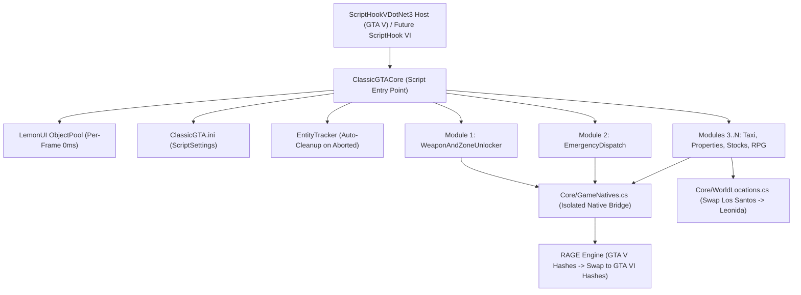

# Tech Stack, Architecture & Legal Compliance Guide

This document specifies the **\$0 engineering stack**, the **engine-agnostic RAGE abstraction architecture** designed for a clean GTA V → GTA VI PC port, and the **Rockstar / Take-Two Legal Compliance Audit**.

---

## 1. Zero-Cost (\$0) Tech Stack

| Layer | Tool / Library | Version / Target | Cost | Role in Project |
| :--- | :--- | :--- | :-: | :--- |
| **IDE & Compiler** | Visual Studio Community Edition | 2022+ (`.NET Desktop Development` workload) | \$0 | Compiles C# 7.3 Class Library (`.dll`) targeting `.NET Framework 4.8` (`x64`). |
| **Runtime Framework** | Microsoft `.NET Framework` | `4.8` | \$0 | Required runtime for `ScriptHookVDotNet3` and `LemonUI.SHVDN3`. |
| **Native Script Hook** | `ScriptHookV` (Alexander Blade) | Latest matching your `GTA5.exe` build | \$0 | Injects `dinput8.dll` ASI loader and exposes RAGE native invoker in Story Mode. |
| **C# Script Bridge** | `ScriptHookVDotNet3` (SHVDN v3) | `v3.6.0+` (or SHVDN3 Enhanced for GTA V Enhanced) | \$0 | Runs C# `.dll` scripts in `GTA V/scripts/` and supports instant in-game hot-reload via the `Insert` key. |
| **UI Framework** | `LemonUI.SHVDN3` | Latest `v2.x` NuGet / GitHub release | \$0 | Native Rockstar-style menus, checkboxes, submenus, and lists without writing Scaleform manually. |
| **Input & Keybinds** | `System.Windows.Forms` | Built into `.NET Framework 4.8` | \$0 | Provides `Keys` enum (`Keys.F9`, `Keys.F10`, `Keys.F11`) for SHVDN3 `KeyDown` events. |
| **Persistence** | `GTA.ScriptSettings` (`.ini`) | Built into `ScriptHookVDotNet3` | \$0 | Saves module toggles, owned properties, vehicles, RPG stats, and stock portfolios to `scripts\ClassicGTA.ini`. |
| **Version Control** | Git + GitHub | Free tier | \$0 | Source control, branching per module, and release packaging. |

---

## 2. GTA V Legacy vs. Enhanced Edition & BattlEye Safety

> [!WARNING]
> **GTA V PC Edition Split (2025–2026):** Rockstar now distributes both **GTA V Legacy** and **GTA V Enhanced** on PC, and enforces **BattlEye anti-cheat** for GTA Online.

| Edition | Modding Stability | Recommendation |
| :--- | :--- | :--- |
| **GTA V Legacy** | **Highest** — Official `ScriptHookV` + `ScriptHookVDotNet3` v3.6.0+ + `LemonUI.SHVDN3` work out of the box. | **Recommended** for Phase 1–4 prototyping. |
| **GTA V Enhanced** | **Moderate** — Requires matching Enhanced `ScriptHookV` build + community `ScriptHookVDotNet3 Enhanced` fork; silent patches break hooks more frequently. | Supported if you prefer ray-traced testing, but always back up `GTA5_Enhanced.exe`. |

### Mandatory Offline Safety Rules
1. **Disable BattlEye:** In Rockstar Games Launcher → Settings → uncheck **BattlEye** (or add `-nobattleye` in Steam/Epic launch options).
2. **Story Mode Only:** `ScriptHookV` automatically blocks GTA Online entry, and you must **never** attempt to load any `.asi` or `.dll` mod into multiplayer.
3. **Executable Backup:** Copy `GTA5.exe` to a local backup folder before launching so an automatic Rockstar update never halts development.

---

## 3. System Architecture (GTA V → GTA VI Abstraction)

The entire mod is built around one golden rule: **Feature modules never call raw GTA V native hashes directly.** Instead, every engine interaction flows through `Core/GameNatives.cs` and `Core/WorldLocations.cs`.



### Key Architectural Patterns

#### A. Dual-Rate Tick Architecture (Zero Frame Drops)
- **Fast Tick (`OnFastTick` — every frame, `0 ms`):**
  - Strictly limited to `LemonUI` `ObjectPool.Process()`, per-frame control overrides (`EnableControlThisFrame`), and active custom camera/HUD drawing.
  - **CRITICAL RULE:** Never call `Script.Wait(...)` inside a script that owns a `LemonUI` `ObjectPool`, or the menu will freeze/flicker!
- **Slow Tick (`OnSlowTick` — throttled every `250 ms` via `Game.GameTime`):**
  - Handles interior detection (`GET_INTERIOR_FROM_ENTITY`), world-marker proximity checks, passive-income timers, RPG stat XP updates, and AI state transitions.

#### B. Standardized `IModModule` Contract
Every feature module implements `IModModule`:
- `string ModuleName` — Display name for logs and LemonUI.
- `bool IsEnabled` — Runtime toggle backed by `ClassicGTA.ini`.
- `void Initialize(NativeMenu parentMenu)` — Registers its menu items and loads config.
- `void OnFastTick()` — Per-frame lightweight logic.
- `void OnSlowTick(int gameTimeMs)` — Throttled 250ms logic.
- `void OnKeyDown(KeyEventArgs e)` — Hotkey handler (`F9`, `F10`, `F11`).
- `void Dispose()` — Guaranteed cleanup of blips, peds, vehicles, and props on `Aborted` / `Insert` hot-reload.

#### C. Recommended Solution Folder Structure
```text
ClassicGTAOverhaul/
├── ClassicGTAOverhaul.csproj      # .NET Framework 4.8, x64, C# 7.3
├── Core/
│   ├── IModModule.cs              # Module lifecycle interface
│   ├── GameNatives.cs             # ONLY file containing GTA V native hex hashes
│   ├── WorldLocations.cs          # ONLY file containing map coordinates (swap for GTA VI)
│   ├── EntityTracker.cs           # Tracks spawned entities/blips for leak-free cleanup
│   └── ConfigManager.cs           # ClassicGTA.ini persistence wrapper
├── Modules/
│   ├── Tier1/
│   │   ├── WeaponAndZoneUnlocker.cs
│   │   └── EmergencyDispatch.cs
│   ├── Tier2/
│   │   ├── TaxiMissions.cs
│   │   ├── PropertyMarket.cs
│   │   ├── BusinessEmpire.cs
│   │   ├── VehicleDealerships.cs
│   │   ├── StockMarketModule.cs
│   │   ├── FirstPersonCamera.cs
│   │   └── RpgStatsModule.cs
│   └── Tier3/
│       ├── PetCompanionModule.cs
│       ├── DualWieldModule.cs
│       └── ProneCrawlModule.cs
└── ClassicGTACore.cs              # Single SHVDN3 Script host (optional unified runner)
```

---

## 4. Rockstar Games & Take-Two Legal / DMCA Compliance Audit

Based on Rockstar Games' Official Mod Guidelines and Take-Two Interactive's enforcement history, this project enforces **5 hard legal guardrails**:

| Policy Pillar | Prohibited (Triggers DMCA / C&D) | Our Strict Compliance Rule |
| :--- | :--- | :--- |
| **1. No Cross-Title IP Porting** | Ripping GTA V vehicles, maps, audio, or models into GTA VI (or vice versa). | **100% Native Assets Only:** Scripts only spawn models/props already shipped inside the host game. |
| **2. No Official Story Rewrites** | Modifying canon story missions, protagonist plots, or cutscenes. | **Pure Sandbox Layer:** All missions (Taxi, Rampage, Contracts, Vigilante) are procedural free-roam side activities. |
| **3. Offline Single-Player Only** | Injecting into GTA Online, bypassing BattlEye for multiplayer, or cheat menus. | **Strict Offline Guard:** Offline Story Mode only; no network/multiplayer hooks. |
| **4. Zero Commercialization** | Paywalled mods, Patreon-locked builds, virtual currency sales, crypto/NFTs, or real-money gambling. | **100% Free & Open Source (\$0):** Casino mini-games use strictly fake in-game Story Mode cash. |
| **5. No Third-Party IP / Branding** | Real-world car logos, copyrighted movies in theaters, or Rockstar trademark logos implying official endorsement. | **Original Parody & Native Channels:** Cinema uses native in-game TV channels; clear disclaimer of non-affiliation. |
