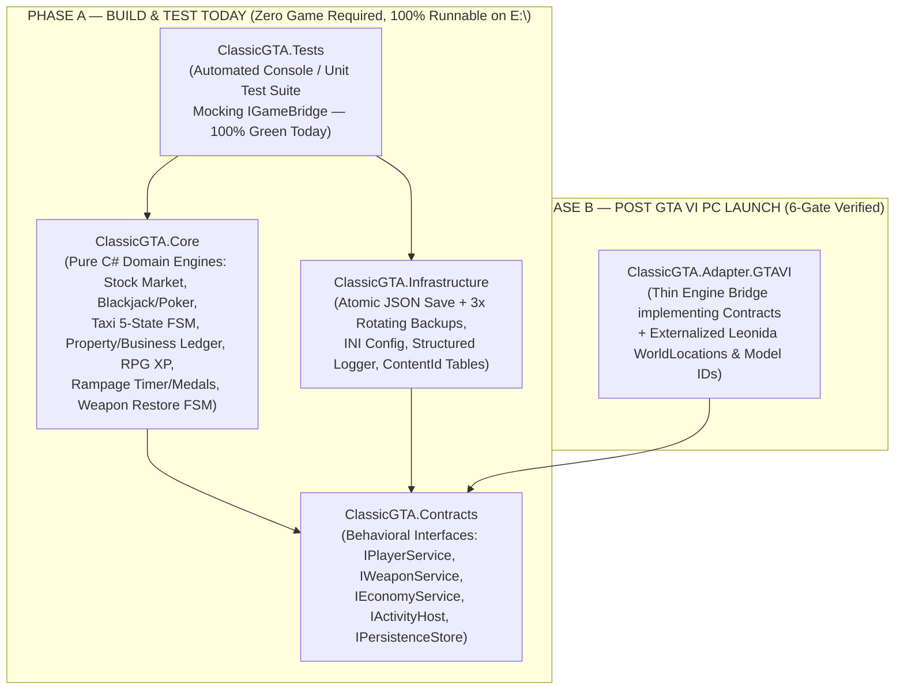

# Unified Master Plan: "Classic GTA" Overhaul Mod (Post-`/kee` & Multi-LLM Synthesis)

> [!IMPORTANT]
> **Single Source of Truth:** This document supersedes earlier drafts by reconciling our `/kee` audit (`05_KEE_Audit_Report.md`), `ADJUDICATION.md`, `PLAN-Module1.md`, the `GPT ClassicGTAOverhaul_Engineering_Pack`, and all 9 Multi-LLM research files against your **actual machine constraints**:
> 1. **Direct-to-GTA-VI Strategy** (no GTA V installed on this machine).
> 2. **Strict `E:\Classic GTA overhaul mod for PC\` Only** (zero downloads, NuGet caches, or builds written to `C:\`).
> 3. **Visual Studio Already Installed** (MSBuild available; zero-cost \$0 stack).

---

## 1. The Honest Reality Check (What You Can Build & Prove TODAY vs. Post–GTA VI PC Launch)

Every credible document in the corpus (`ADJUDICATION.md`, `PLAN-Module1.md`, `Claude Sonnet 5.5`, `GPT Pack`, `Kimi`, `Qwen 4 MASTER`) agrees on one non-negotiable truth:

> **As of November 2026, GTA VI (PC), Script Hook VI, and any GTA VI native database DO NOT EXIST.**
> Any document promising a "30-minute hash swap" or citing `ScriptHookVIDotNet.dll` / `VCPD_Cruiser` is hallucinating and has been **quarantined** (specifically `Restoring the Classic Sandbox` and the invented claims in `GEmini Argon Research`).

### What This Means for Your Strategy
Because you are going **directly to GTA VI (PC)** without installing GTA V, writing raw `ScriptHookVDotNet3` / `GTA.Native.Hash` code today would be **untestable dead code**. Instead, we invert the build order so **100% of what we write today compiles, runs, and passes automated tests on your PC right now**, and is genuinely portable when GTA VI (PC) ships:



---

## 2. Corpus Reconciliation: Best Ideas Adopted vs. Traps Quarantined

| Adopted (Best-in-Class Across All Docs) | Source | Rejected / Quarantined | Source |
| :--- | :--- | :--- | :--- |
| **Behavioral Service Interfaces** (`IPlayerService`, `IWeaponService`, `IEconomyService`, `IVehicleService`, `IClock`, `IPersistenceStore`) instead of raw `GameNatives` hash wrappers | `GPT Pack`, `Kimi`, `Sonnet 5.5`, `/kee` | **`Restoring the Classic Sandbox` (S2)** — hallucinated APIs (`Game.GameTimeDelta`, `Output.WriteLine`, `UI.Notify`), contradictory allow-list, 100m town-center hack | `ADJUDICATION` |
| **Pure-C# Core + Automated Offline Test Suite** (runnable via MSBuild with zero game install) | `PLAN-Module1`, `Sonnet 5.5`, `Kimi`, `/kee` | **Invented GTA VI APIs** (`ScriptHookVIDotNet.dll`, `VCPD_Cruiser`, "30-min hash swap") | `Argon (G2)` |
| **Atomic Persistence (`temp -> 3x rotating backup -> atomic replace`)** using versioned JSON (`SchemaVersion`, `SaveRevision`, stable `ContentId` keys) + `.ini` strictly for simple user toggles | `Kimi`, `GPT Pack`, `Qwen`, `/kee` | **Hardcoded `9999` ammo & blind `SET_CAN_ATTACK_FRIENDLY`** (causes friendly-fire mission breaks) | `Argon (G2)`, `Gemini (G1)` |
| **3-Tier Scheduler (`0ms` / `250ms` / `1000ms`) + Per-Module Fault Isolation** (if one module throws, suspend *only* that module—never crash the host) | `Sonnet 5.5`, `Kimi`, `Argon` | **`Script.Wait()` inside `Tick`** (freezes UI/input) and **unconditional 1s `TASK_VEHICLE_DRIVE_TO_COORD`** (breaks AI pathing) | `Argon (G2)` |
| **Three-Way Entity Ownership (`Owned` / `Borrowed` / `Detached`)** + separate `Blip` tracking + restore `RenderingCamera` before delete | `Kimi`, `Argon`, `PLAN-Module1` | **Destructive `F10` toggle / removing weapons on `Aborted`** (destroys player's real save loadout) | `PLAN-Module1`, `GPT Pack` |
| **Idempotent Economy Transactions:** validate → deduct → persist → *refund if persist fails* → spawn; settle payouts *before* awarding cash; cap passive income (`OfflineCapDays = 7`) | `Kimi`, `Qwen 4 MASTER` | **False-promise features:** Story Mission Replay (#17) and unlicensed Cinema clips (#13) must be honestly scoped as `[SANDBOX SUBSTITUTE]` | `/kee`, `Sonnet 5.5` |
| **6-Gate GTA VI Porting Policy** (official PC release, public modding interface, permissive license, legal tools, clean install, verified APIs — zero leaks) | `Qwen 4 MASTER`, `PLAN-Module1` | **Hardcoded `C:\` paths & global NuGet cache on `C:\Users\...`** | `/kee` (User Rule) |

---

## 3. E:-Drive-Only Local Workspace Architecture (Zero `C:\` Writes)

To strictly honor your rule (**keep everything inside `E:\Classic GTA overhaul mod for PC\`, nothing on `C:\`**) and work with your installed Visual Studio / MSBuild:

1. **Local NuGet Config (`E:\Classic GTA overhaul mod for PC\nuget.config`):**
   - Redirects `globalPackagesFolder` to `.\.packages` inside the workspace so **zero bytes** are written to `C:\Users\<user>\.nuget`.
2. **Local Reference Assemblies (No `C:\` VS Installer Changes Required):**
   - If the `.NET Framework 4.8` targeting pack is missing on `C:\`, we include `Microsoft.NETFramework.ReferenceAssemblies` (`PrivateAssets=all`) inside `.\.packages\`—letting your existing `MSBuild.exe` compile cleanly with zero `C:\` installs!
3. **Classic / Clean Solution Structure inside `E:\Classic GTA overhaul mod for PC\`:**
   ```text
   E:\Classic GTA overhaul mod for PC\
   ├── nuget.config                        # Forces all packages into .\.packages\
   ├── .packages\                          # Local NuGet cache (zero C:\ writes)
   ├── ClassicGTAOverhaul.sln
   ├── src\
   │   ├── ClassicGTA.Contracts\           # Zero-dependency behavioral interfaces & DTOs
   │   ├── ClassicGTA.Core\                # Pure C# game systems (all 26 features' logic)
   │   ├── ClassicGTA.Infrastructure\      # Atomic JSON save, INI config, Logger, Scheduler
   │   └── ClassicGTA.Adapters\            # Future Adapter.GTAVI (built post-PC launch)
   └── tests\
       └── ClassicGTA.Tests\               # Automated test runner (100% runnable today!)
   ```

---

## 4. Revised Step-by-Step Build Plan (What We Build Now vs. Later)

### Phase 1: Foundation & Proven Test Harness (Build & Verify NOW)
1. Scaffold `nuget.config`, `ClassicGTAOverhaul.sln`, `ClassicGTA.Contracts`, `ClassicGTA.Core`, `ClassicGTA.Infrastructure`, and `ClassicGTA.Tests` inside `E:\Classic GTA overhaul mod for PC\`.
2. Verify `MSBuild.exe` builds **0 Errors, 0 Warnings** and `ClassicGTA.Tests.exe` runs and passes.
3. Build **Module 1 Core (`WeaponAndZoneController`)** against `IWeaponService` + `IGameContext` (including all 8+ `/kee` state-matrix tests: cutscenes, pause, character-switch handle change, timer wrap-around, non-destructive `F10` Pocket Arsenal, `IsWeaponValid` + `HashSet<uint>` deduplication, `MaxAmmo` cap).

### Phase 2: 100% Portable Pure-C# Engines (Build & Unit-Test NOW — Zero Game Needed!)
Every one of these complex systems can be **fully coded and battle-tested with automated tests before GTA VI PC even launches**:
1. **Economy & Persistence Engine** (Features `#1, #2, #3, #4`): Atomic JSON save + 3× rotating backups, Property ownership, Business passive-income scheduler (`OfflineCapDays = 7`, idempotent payout ledger), Vehicle dealership ownership catalog.
2. **Stock Market Simulation Engine** (Feature `#5`): Ticker simulation, volatility curves, buy/sell portfolio ledger, and contract-triggered rival stock crashes.
3. **Side-Hustle State Machines** (Features `#8, #9, #10, #17`):
   - Taxi 5-state FSM (`Idle → Searching → Pickup → EnRoute → Payout` + timeout/cleanup + completed-once guard).
   - Vigilante / Paramedic / Firefighter wave & arrival state machines.
   - Rampage timer, kill-counter, and Bronze/Silver/Gold medal evaluator.
4. **RPG Skill & XP Progression Engine** (Feature `#20`): Stamina, Driving, Flying, Shooting, Lung Capacity curves + perk thresholds.
5. **Casino Card Games Engine** (Feature `#15`): Rules-complete Blackjack & Video Poker (pure virtual cash).

### Phase 3: GTA VI (PC) Adapter & Integration (Gated by 6-Gate Policy Post-Launch)
Once GTA VI (PC) + an official/publicly verified script hook launch:
1. Build `ClassicGTA.Adapter.GTAVI` implementing `IPlayerService`, `IWeaponService`, `IVehicleService`, `IEconomyService`, `ICameraService`, and `IUIService`.
2. Populate externalized `ContentId` data files (`LeonidaLocations.json`, `GTAVIModels.json`) — zero code rewrites in `Core`.
3. Run the **Measurement Protocol** (log every interior intervention, 30 consecutive hot-reloads, 30-minute soak test, entity/blip count baseline check).
4. Time-box Tier 3 physics/animation spikes (**3 sessions max each**) for Prone (#21), Dual-Wield (#22), Skateboarding (#16), Guard Dogs (#26), and Mini-Games (#11, #12, #14).
